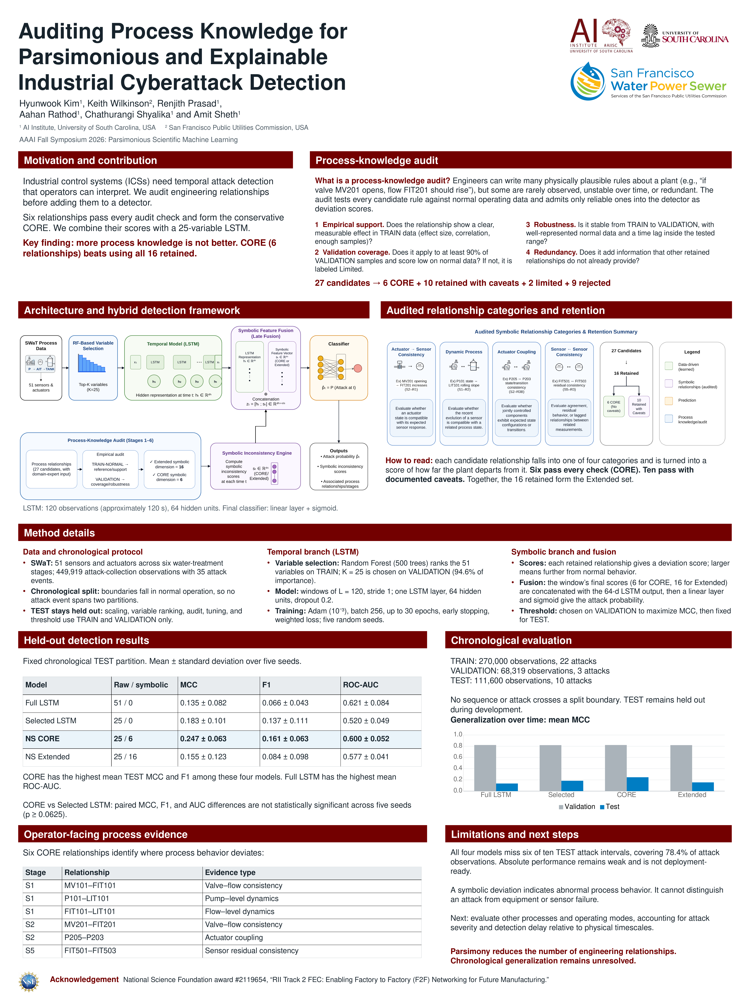

# Auditing Process Knowledge for Parsimonious and Explainable Industrial Cyberattack Detection

**AAAI Fall Symposium 2026: Parsimonious Scientific Machine Learning**

**Authors:**
Hyunwook Kim¹, Keith Wilkinson², Renjith Prasad¹, Aahan Rathod¹, Chathurangi Shyalika¹, Amit Sheth¹  
*¹ AI Institute, University of South Carolina, USA*  
*² San Francisco Public Utilities Commission, USA*

---

## Paper

📄 **[Read Paper in Browser (PDF)](./FSS-26_Paper_XXX_1825.pdf)**

## Abstract

> Industrial Control Systems (ICSs) require attack detection that captures temporal behavior while remaining interpretable to operators. Engineering-informed detectors often incorporate physically plausible process rules, but such rules may be unreliable, redundant, or unhelpful for detection. We therefore study a different question: which engineering relationships should actually be admitted into a detector? Using the Secure Water Treatment (SWaT) dataset, we audit 27 candidate process relationships against training and validation data. Six relationships that pass all audit checks form a conservative CORE representation, while 16 are retained overall. We combine CORE with a 25-variable LSTM and evaluate it on a fixed chronological test partition across five random seeds. CORE achieves the highest mean test MCC (0.247) and F1 (0.161), compared with 0.183 and 0.137 for the LSTM alone. Using all 16 retained relationships performs worse than CORE, suggesting that more process knowledge does not necessarily improve detection. However, all models perform substantially worse on the chronological test data than on validation data, revealing a major limitation in generalization over time. Our contribution is a systematic way to audit engineering knowledge before incorporating it into a hybrid detector, favoring a smaller and more interpretable representation.

---

## Poster

- **Presentation Source:** [`Cyberattack_Detection_Poster_v2.odp`](./Cyberattack_Detection_Poster_v2.odp)
- **Vector PDF:** [`Cyberattack_Detection_Poster_v2.pdf`](./Cyberattack_Detection_Poster_v2.pdf)
